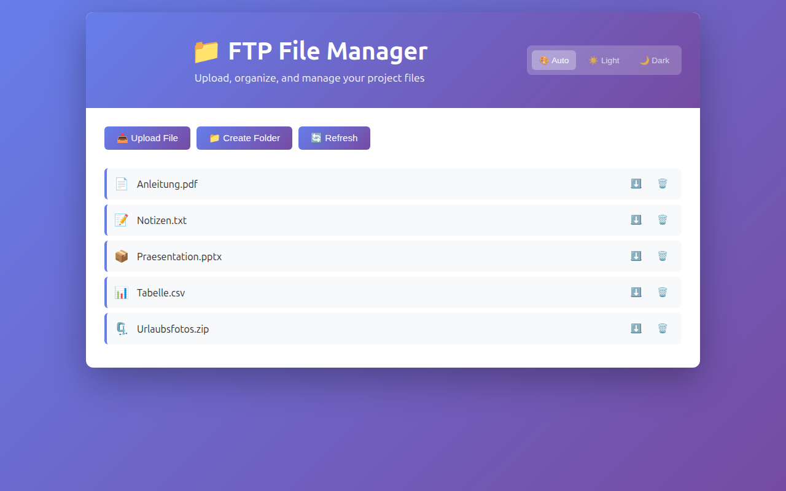
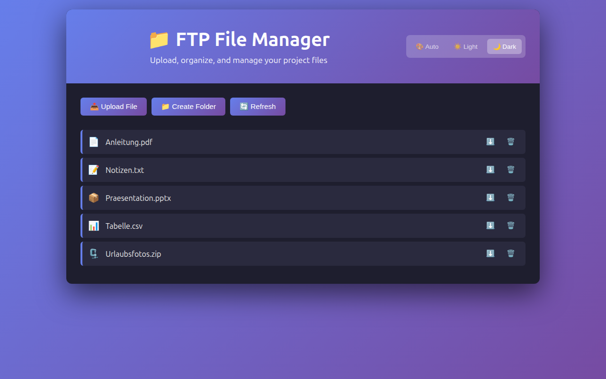

# FTP Webpage - File Browser
Eine minimalistische Webanwendung zur Anzeige und zum Herunterladen von Dateien aus einem lokalen Verzeichnis.



## Features

- 📁 Automatische Auflistung von Dateien im `html/`-Verzeichnis und `html/files/`-Unterordner
- 🎨 Modernes, responsives UI
- ⬇️ Direkte Download-Funktionalität
- 🔒 Sicherheit gegen Directory-Traversal-Attacken
- 🚀 Express.js basiert, minimale Abhängigkeiten

## Screenshots

| Ansicht | Beschreibung |
|---|---|
|  | Dateiliste mit Hochladen, Ordner anlegen, Download und Löschen. |
|  | Dunkles Design (Umschalter oben rechts: Auto, Hell, Dunkel). |

## Voraussetzungen

Docker mit Docker Compose oder Node.js (siehe „Verwendung“). Die Anwendung hat **keine Anmeldung**: Betreibe sie nur in einem vertrauenswürdigen Netz oder hinter einem Reverse Proxy mit Zugriffsschutz.

## Bedienung

1. Seite öffnen (Standard: Port 3003).
2. **Upload File** wählt eine Datei aus und legt sie im Ordner `html/files/` ab.
3. **Create Folder** legt einen Unterordner an.
4. Pfeil-Symbol lädt eine Datei herunter, Papierkorb löscht sie. **Refresh** liest den Ordner neu ein.
5. Oben rechts wechselst du zwischen Auto, Hell und Dunkel.

## Daten und Backup

Alle Dateien liegen im Ordner `html/` des Projekts (per Volume `./:/app` im Compose). Sichere diesen Ordner, um alle Dateien zu sichern.

## Update und Fehlersuche

- Update: neuen Stand des Projektordners einspielen, dann `docker compose up -d`.
- Seite nicht erreichbar: `docker compose ps` prüfen, Port 3003 muss frei sein (`PORT` anpassbar).
- Datei erscheint nicht: **Refresh** klicken; versteckte Dateien (Name beginnt mit `.`) werden bewusst ignoriert.

## Struktur

```
ftp_webpage/
├── server.js              # Express-Server
├── default-index.html     # Standard-Dateibrowser (Fallback)
├── package.json           # Dependencies
├── docker-compose.yml     # Docker-Konfiguration
└── html/                  # Webroot (wird beim Start erstellt)
    ├── index.html         # (optional) Benutzerdefinierte Startseite
    └── files/             # Datei-Verzeichnis
        └── (deine Dateien hier)
```

## Verwendung

### Lokal starten (mit Node.js)
```bash
npm install
npm run dev
```

Die App läuft auf `http://localhost:3003`

### Mit Docker
```bash
docker compose up -d
```

## Dateien hinzufügen

Platziere deine Dateien in:
- `html/` - Dateien in der Wurzel
- `html/files/` - Dateien im Ordner "Files"

Beide Verzeichnisse werden automatisch erstellt und gescannt.

## Custom HTML

Erstelle eine `html/index.html`, um eine benutzerdefinierte Startseite zu verwenden. Die Default-Seite wird als Fallback verwendet.

## API

### GET /api/files
Gibt eine JSON-Liste aller verfügbaren Dateien zurück:
```json
[
  {
    "name": "document.pdf",
    "path": "/download/document.pdf",
    "location": "root"
  }
]
```

### GET /download/:path
Lädt eine Datei herunter (mit Sicherheitsprüfung)

## Sicherheit

- Directory-Traversal-Schutz (`../` wird blockiert)
- Alle Dateizugriffe sind auf das `html/`-Verzeichnis beschränkt
- Versteckte Dateien (`.`) werden ignoriert

## Download

Über **Code → Download ZIP** oder unter **Releases** auf GitHub.

## Lizenz

Noch nicht festgelegt.

---

## English summary

FTP Webpage is a lightweight browser file manager (Node.js/Express, no database): list, upload, download and delete files of a folder, with light/dark theme. It has no login and should only run in a trusted network. Start with `docker compose up -d` (port 3003).
